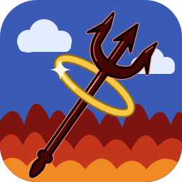

# Halos & Horns



A free, non-commercial prop-hunt game: demons possess everyday objects to hide, angels hunt them down.
Passion project, inspired by Witch It.

## Status: version 0.5.5, Creative mode, Godot 4.7

One small test map (the Playground), placeholder shapes for everything, and Creative mode for building your own.

- **Creative (build maps):** from the main menu. Hold right mouse to look around, WASD to fly (Space/E up, Q down, Shift faster). Pick a piece on the left (blocks, cylinders, bouncies, the shrine, the angel and demon starts, about 260 props and 300 structures) and click in the world to place it. The left-hand list shows a little picture of each piece, folds into categories (Graveyard, Furniture, Kitchen & food, Dungeon & castle, Town, Village & nature) and has a search box. Once a piece is picked, a see-through copy follows the mouse to show where it'll go, and **Shift + mouse wheel** turns it (15° a notch, hold Alt for 1°); with nothing picked, Shift + wheel turns the selected piece. For fine placing: the snap step goes down to 5 cm, holding Alt turns snapping off, the **arrow keys** nudge the selected piece one snap step (Alt: 1 cm) along the map's axis nearest where you're looking, and **Page Up / Page Down** raise and lower it. **Props** are things demons can possess. **Structures** are solid scenery in their real shape: walls with doorways and windows, floors, stairs, pillars, fences, crypts, houses, towers, trees, hills, roads. T stretches a structure on any axis, and a selected structure has glowing **pull tabs**: drag a wall's or fence's end tab and it repeats end to end, posts and columns included, from either end (the other end stays put). Floors, rugs, roads and paths have tabs on all four sides, so they pull out into a grid. Stairs pull out upward: each new flight starts at the top of the last, so the staircase gets longer. (V does the same as the far-end tab.) **Settings** (music, sound, graphics, keys) is on the top bar. **Time** on the top bar makes the map day, dusk or night (with stars), **Day cycle** makes time pass (a whole day and night in 5 to 30 minutes, the same for everyone), and **Weather** picks sunny and clear, sunny with clouds, cloudy, light fog, snow or rain. The **Light** piece places a lamp with its own colour, reach and brightness, or a **spotlight** that shines one way (its bulb only shows in Creative); lanterns, torches, candles, jack-o'-lanterns and street lights glow on their own. **Ice** is a slippery sheet: anyone running on it and turning hard slips and falls for a moment. **Ctrl + mouse wheel** (or Look in the right panel) changes a structure's look: weathered, clean, mossy, charred, aged, shadowy, icy or bloodstained. **Alt + mouse wheel** makes the selected piece bigger or smaller, keeping its shape (props grow and shrink evenly, 50% to 200%, and a demon disguised as a resized prop matches its size). Cars can have their lights on, traffic lights change by themselves, and there's a road piece with the crosswalk at one end. When you scroll down the palette, the line at its top says where you are (e.g. "Structures > Furniture"). Click a piece to select it; press on it and drag to move it (it slides over whatever is under the cursor, so you can drag things onto roofs), or use G move, R rotate, T resize; while doing that, X / Y / Z keep it to one axis, L switches between the map's axes and the piece's own, and holding Alt turns snapping off. Ctrl+D copies, Delete removes, F flies to it, Ctrl+Z / Ctrl+Y undo and redo. The right-hand panel takes exact numbers; 0, 0, 0 is the middle of the map. Save, then **Test play** to run a round on it (only a 3-second hide), and Esc → Back to Creative to keep building. Creative **autosaves** every 10 minutes if anything changed (a new map is saved under its name, or as "name (autosave)" if that's taken). Holding an arrow key keeps nudging; **Shift + arrow** slides the piece until it touches the next one. **Special structures** (top of the palette) has the bouncies, lights, shrine, starts and **Window pictures** (stick one on a window: a living room, kitchen, bedroom, library or plain lit pane, glowing brighter at night); **Ground** has the floors, roads, paths, **Sidewalks** and ice. Lights have a **daylight sensor** (on at dusk, off at dawn, sputtering as they come on) unless you tick **Always on**, a **Flicker** rate, a **Cone** width and a **Tilt** for spotlights; street lights and lantern posts follow the daylight too. **Scenery** on the top bar puts rolling hills, an ocean, mountains or a city skyline past the walls. Rain leaves puddles (and a rainbow in daylight), snow piles up on the tops of things over a few minutes and brings out Christmas lights, and "sunny, some clouds" has big puffy clouds. Traffic lights have street signs (Angel Avenue and Devil Drive), and the graveyard pines come in green too. Bouncy pads come in five colours each (Look, or Ctrl + wheel). **Ctrl + click** selects several pieces at once: they move, turn, nudge, copy and delete together, and changing a look, colour or light setting changes all of the same kind. **Ctrl + G** makes them a group (clicking any one selects them all; Alt + click picks just one), Ctrl + Shift + G ungroups. Walking through snow leaves slushy tracks (Hellfire melts it) that fresh snow fills back in. **Ground** also has resizable **Grass, Dirt, Gravel, Landscaping, Flowerbed and Sand blocks**, **Walk-in buildings** (top of the palette) are houses, shops and barns with real doorways, floors and stairs you can hide and hunt inside, and rugs take any **Colour**. Test play works on your own too, even while building together online (you play as a demon and the round never ends until you leave).
- **Build together:** online, the host clicks **Build together** in the lobby and everyone goes into Creative on the lobby's map. Everyone sees everyone else's changes as they happen, and each builder shows up as a glowing ball with their name. A piece someone has selected is outlined in their colour and is theirs until they let go. Undo only takes back your own changes. The host checks every change (so a cheater can't wreck the map), can make anyone view-only from the Builders list on the right, saves the map on their computer, and clicks **Done building** to go back to the lobby with the map ready to play (or **Test play** to go straight into a round on it). Joiners can **Save a copy** to their own maps folder.
- **Shared maps:** in Settings, **Shared maps folder → Choose...** picks a folder that OneDrive, Dropbox, Google Drive (or similar) keeps in sync with friends. Its maps appear in Creative's Open list and the lobby's map picker marked "(shared)", and ticking **Shared** next to Creative's Save saves there. Everyone edits whenever they like, on their own PC. If someone else saved a shared map while you had it open, your save goes into "<name> (<your name>'s copy)" instead of overwriting theirs.
- **Maps** are plain data files (no code, so a map can't do anything but be a map), saved in your maps folder (Creative has a button that opens it). The host picks the map in the lobby; everyone who joins gets it automatically.

- **Practice:** single player. The angel side hunts 3 test demons (they hop and taunt so you can find them); the demon side is a sandbox for possessing props.
- **Online:** one player hosts, friends join with a five-letter room code (no port forwarding), or by address. Mobification rules: caught demons are redeemed and switch to the angels. About one angel per three players.
- **Skills:** pick 2 per side on the main menu or in the lobby. Angels: Flying Dash (dash where you look or the way your keys point, up into the air too; you keep the momentum until you turn: wide turns cost a little, a quick 180 or a strafe kills it), Alarm Cherub (thrown), Vacuum Orb (a vortex that sucks for 3 s: drags props in and keeps yanking any demon within 8 m back to its middle, draining Hatred; caught demons can't use skills until 2 s after it ends), Holy Leap (picked, every jump goes MUCH higher and steers hard in the air; press its key while in the air to Cloud Stomp straight down from there, hurting every demon within 6 m of where you land: most in the middle, up to double from high up), Holy Scripture (a heavy book that heat-seeks the nearest demon, or Minion, up to 14 m ahead of it; wherever it lands it smites, a pillar of holy light and a bell BONG that hurts every demon within 4 m, shoves them back and locks their skills for 1.5 s; a direct hit hurts even more), Holy Kick (boot a demon away), Holy Word (a shout down your crosshair, 8 s cooldown: a demon it catches flying more than 2 m up is struck out of the sky, can't fly again until it lands, and is stunned stiff for 0.5 s). Demons: Possess, Fly, Teleport (to your crosshair, up to 20 m; expensive), Minion (a decoy that quietly appears where you aim, looking like you, or like some prop from the map if you're disguised; hold its key to steer it to the ground under your crosshair, Left Alt makes it jump; it moves like a real player, hits on it look and sound real, but it pops after a hit or two, and a Vacuum Orb evaporates it whatever it looks like), Hellfire (costs Hatred; it splashes into extra pools around where it lands, how many is in Settings & controls, the host's setting counts online; angels in the fire are slowed and their blessings burn away, and an Alarm Cherub left in it burns up), Fear (a hellish shriek: angels within 10 m who can see you panic for 2 s, scattering away from you with their aim shaking all over; 55 Hatred, 7.5 s cooldown).
- **Demons** can **transform** into a copy of any prop (click), or with skills **become** the real one (Possess) and **fly** (hold the key: you rise while Hatred lasts, gravity brings you down; no fall damage).
- The Alarm Cherub just hovers there tooting its little horn until a demon comes close; then it blasts the horn and shows its detection bubble. Shoot it with a blessing to send it flying down a hallway.
- **Power-ups:** angels drop demon power-ups as they go, about one every 50 s at most two lying around (more often with more players and the more the demons move about): Hatred Surge, Fire Burst, Invisibility (6.5 s, angels get no trace of you), Unholy Mending (+50% of your starting health per pickup, up to 150%; turns up most often). Each team only ever sees its own team's power-ups. About half the redeemed demons drop an angel power-up (two at most lying around), and an angel who hasn't found or hit anyone for 55 s gets one dropped nearby: Cherub Sense (a little cherub dangles over your head, and you go off like an Alarm Cherub near demons; everyone sees the cherub flapping over your head, demons too), Quick Blessings, Quick Skills (also resets every cooldown the moment you grab it), Endless Sprint. Dropped power-ups fall to the ground, and one nobody takes counts down its last 8 seconds before it disappears. While a timed power-up is on you, you glow with its own colour of particles that **everyone** can see (gold sparkles: Cherub Sense, white-gold sparks: Quick Blessings, blue spiral: Quick Skills, green streaks at the feet: Endless Sprint, red embers and smoke: Hatred Surge), except while you're disguised as a prop or invisible.
- **Chat:** "(All)" and "(Team Only)" mark who a line went to. Chat text size is in Settings & controls (each player picks their own). The lobby has its own chat box while you wait.
- **Effect icons:** the top-right corner shows an icon for everything you're under, bad (red rim: Hellfire, Fear, Vacuumed) or good (green rim: your power-ups), with a ring that drains as it runs out.
- **Sounds:** a flying demon makes an eerie musical-saw wail with wing beats that **everyone** nearby hears (disguised or not: flying gives you away), and a demon that gets hit grunts.
- **Music:** an original goofy-spooky soundtrack, composed and synthesized in the game's own code (no audio files): a theremin waltz in menus and lobbies, a tiptoeing sneak while the demons hide, an organ-and-choir chase during the hunt, and a fanfare or a droopy "aww" when a round ends. The first launch builds the songs in the background (a few seconds) and keeps them for next time.
- **Loose props get knocked about:** blessings nudge them, a melee swing or a Holy Kick with no demon in reach boots the nearest one, and a Cloud Stomp or a Fire Burst blasts everything nearby outward. Tall things tip over, round things roll, squat things rock, and a prop sliding into another shoves that one too. The host decides every shove and sends where each prop ends up, so every screen matches. Running into a loose prop shoves it too, and running into a demon disguised as a prop shoves that demon about as far, so a prop that won't budge never gives anyone away. A Cloud Stomp also shoves the demons it hurts 2 m outward.
- **Music:** the hunt plays one of four songs, picked each round (everyone online hears the same one): the original chase, "The Graveyard Shuffle", "Phantom Tango" and "Dance of the Bones". All composed and synthesized in code.
- **Wardrobe** (main menu or lobby): dress your angel and your demon a piece at a time: halo or horns, head (with or without its hat), upper body and arms (with or without the cape), lower body and legs, skin colour, and your blessing type (angels) or flame colour (demons). Each team has its own wardrobe: angels mix pieces from the five adventurers, demons from the four skeletons (themes match across the teams: Knight and Skeleton Warrior, Mage and Skeleton Mage, Rogue and Skeleton Rogue), and each has its own skin colours; save outfits as presets, or start from a matching set. Demon horns come in six kinds, each its own twisted, ridged shape and colouring: devil horns with ember tips, curled ram horns, scimitar goat horns, cracked lava nubs, ivory corkscrews and four violet horns. Everyone online sees your outfit, and your minion wears it too. Every outfit piece comes with its own trimmings (angels: gold, stars, suns and feathers; demons: rusted iron, chains and glowing embers). Angels have feathered wings; demons are smaller, with bone-white skulls by default and scaly dragon wings that spread when they fly.
- **Moving about:** you walk straight up stairs (they have a smooth ramp under the steps), curbs and ledges up to half a metre; props and players still block you. Sneaking crouches you down.
- **Impact:** a redeemed demon explodes (fireball, shockwave, flying chunks, a boom, nearby props blown back), every blessing hit makes a burst of sparks, and being hit yelps, flashes red and jolts the camera. A Holy Leap stomp lands with a thunderclap.
- **Room code:** once you're in a lobby through the relay, the room code sits big and faint at the top of the screen, and Settings shows it with a Copy button (handy for pasting into Discord).
- **Text size:** everything (menus, HUD, Creative) can be made bigger: **Ctrl +** / **Ctrl -** anywhere (Ctrl 0 resets), the **A - / A +** buttons on the main menu, or Text size in Settings, from 80% to 250%. It's remembered. Panels scroll when they're too tall for the screen.
- **Settings & controls** (main menu or Esc): music volume, sound-effects volume, and graphics quality: Low (fast), Medium, or High (light shafts in the haze, bounce light, glowing blessing trails that light up the area). **Show FPS** (off by default) puts the frame rate in the top left corner, with how many triangles and draw calls each frame takes.
- **Feel:** the view widens a touch when you run or dash and leans into strafes, you squash a little on landing, the camera shakes near a stomp or a blast, you can still jump just after running off a ledge, and pressing jump just before landing still counts. The F1 tuning panel can turn each of these down or off.
- **Naughtiness pays:** demons earn Hatred when angels roast in their fire, when their minion soaks a hit, and for taunting right under an angel's nose.
- **Bouncies:** springy pads that fling anyone about 13 m up (thrown Alarm Cherubs and Vacuum Orbs bounce off them too). Riveted metal ones are part of the map; wooden ones work once per round; glowing magic **super-bouncy** pads throw you about 27 m up (the map's ceiling may stop you first).
- **Ledge grab:** angels in the air who push into a wall whose top they could reach pull themselves up onto it.
- **Controls screen:** every action can be rebound to any key or mouse button (main menu or Esc menu).
- **The shrine:** one per map (the stone dais with the floating half-gold, half-red crystal and a SHRINE sign), the only place to swap skills mid-round. Press G there; a swap takes 3 seconds in total, you can't move while at it, demons have to leave their prop first, and the shrine flares up so everyone knows someone is there. Fresh skills start on cooldown.
- **Shrine looks:** the shrine also lets you put on one of the looks you saved in the Wardrobe (or a matching set) with the skill swap.
- **Whack-an-Imp:** while the demons hide, blindfolded angels play a little mouse game on the black screen: bonk the imps popping out of the clouds, spare the cherubs, and chase your best score.
- **No hiding forever in silence:** demons can sit still as long as they like (they never get kicked for it), but a demon that hasn't moved for 20 seconds during the hunt taunts automatically, and again every 20 seconds after that. You get a 5-second warning first, and taunting on your own resets the clock.
- **Chat:** Enter talks to everyone, Backspace to your team only. Everyone is told who redeemed whom, and who the last demon standing is.
- Every prop form has its own health and speed: small = fragile but quick, big = tanky but slow. Your health bar shows how much is left; the number shows real hit points for your current form.

## Playing (Windows)

Download `HalosAndHorns.exe` from the [Releases page](https://github.com/theobigdog/halos_and_horns/releases) and run it. Nothing to install.
Windows may warn "Windows protected your PC" because the game isn't signed; click **More info**, then **Run anyway**.

## Playing (Linux)

Download `HalosAndHorns.x86_64` from the [Releases page](https://github.com/theobigdog/halos_and_horns/releases). Nothing to install, but Linux needs to be told the file is a program before it will run it:

```
chmod +x HalosAndHorns.x86_64
./HalosAndHorns.x86_64
```

(Or in your file manager: right-click the file → Properties → Permissions → allow executing, then double-click it.)

Windows and Linux players can play together.

## Updating

When a newer version is out, the main menu shows an **Update to version ...** button. Click it and the game downloads the new version, checks it, replaces itself and restarts. If the update can't be checked or installed (say, the game sits in a folder it isn't allowed to change), the button opens the download page instead: download the new file there and replace your old one with it.

**How updates are checked:** every release is signed. The release workflow signs each build with a private key kept as a GitHub secret, and the game carries the matching public key. The signature covers the version number, the file name and the file's exact fingerprint, so the game only installs the very file that was signed for that version: not a swapped or damaged file, and not an older build passed off as a newer one. Anything that doesn't check out is never run. (Versions 0.4 to 0.5.2 checked downloads only against a fingerprint that came from the same place as the file; that's why self-updating was off from 0.5.3 until signing came in.)

What signing doesn't cover: someone who takes over the GitHub account could change the workflow and have it sign their file too. Keeping that account safe (two-factor login) is what keeps updates safe.

Making a release (developers): publish a GitHub release tagged like `v0.4.1`. The tag is the version: the build stamps it into the game, so there is no version number to change in the source. Run from source, the game calls itself version "dev". The workflow signs the builds a few minutes later; that needs the `UPDATE_SIGNING_KEY` secret, made once with `bash tools/make_update_key.sh` (which also writes the public key into `scripts/update_key.gd`, to commit). Without it, releases still work, but games only offer the download page.

## Hosting and joining

**Hosting:** click **Host a game**. The lobby shows a five-letter **room code** (it's also copied, so you can paste it straight into Discord). Pick the hiding and hunting times (and, if you like, a time after which idle angels get kicked; you can also kick someone by hand), then click **Start round** once at least 2 players are in. No router setup is needed: games go through a small relay server (see below).

**Joining:** type the room code, click **Join a game**. Everyone needs exactly the same version as the host; anything else is turned away with a message saying which version to get.

**Without the relay** (same Wi-Fi, or if the relay is down): the host clicks **Host directly** instead, and the lobby shows the addresses to use. Friends type the address (instead of a code) and click **Join a game**.
- Friends on the same Wi-Fi use the "same house" address. That needs no setup.
- Friends over the internet use your internet address, which needs **UDP port 7777 forwarded** on your router to your PC (the Port box changes it). Windows will also ask to allow the game through the firewall: allow it. On Linux, if you run a firewall, allow UDP port 7777 yourself.

### The relay server

Room codes work through [game-relay](https://github.com/drewburr-labs/game-relay), a relay Drew runs at `relay.drewburr.com:24680` that any game can use. The host opens a room, friends join it with the code, and the relay passes packets between them, so nobody forwards ports and nobody sees anyone else's IP address. It only passes bytes along and never reads them: the host is still the referee, and everything below about fairness works the same way.
- `relay/` is a copy of the relay's scripts at the tag in `relay/VERSION`. Don't edit them here: `tools/update_relay.sh <tag>` moves them to a newer release (`--check` says whether they still match). `scripts/relay_peer.gd` is what lets Godot's multiplayer run through the relay.
- Limits: one packet can be at most 256 KB (maps are a few KB). The relay can't force someone out of a room, so a kick makes the host ignore that player and tells their game to leave.
- From the command line (after `--`): `--host-relay` hosts through the relay, `--join=CODE` joins by code (or `--join=ADDRESS` directly), `--relay=HOST[:PORT]` uses a different relay, say one running on this PC: `godot --headless -s res://tests/run_relay.gd -- --port=24680`.

## Playing from the source (developers)

1. Download **Godot 4.7.2** (standard, *not* .NET): https://godotengine.org/download/archive/4.7.2-stable/
2. Open Godot, click **Import**, pick `project.godot`, press **F5**.
3. To build the game yourself: Editor → Manage Export Templates → Download, then Project → Export → Windows or Linux. Either one can be built from either operating system.

Both builds are also made automatically: publishing a release on GitHub runs [the release builds workflow](.github/workflows/release-builds.yml), which attaches `HalosAndHorns.exe` and `HalosAndHorns.x86_64` to that release a few minutes later.


The icon is `icon.svg`. After changing it, run `godot --headless -s res://tools/make_icon.gd` to remake `icon.ico` (the Windows .exe and taskbar icon) and `icon.png`.
## Controls

| Key | Angel | Demon |
| --- | --- | --- |
| WASD / Space | Move / jump | Move / jump |
| Shift | Run (uses sprint stamina) | Run (uses sprint stamina) |
| Ctrl | Sneak | Sneak |
| 1 | Random taunt | Random taunt |
| 2 | Signature taunt | Signature taunt |
| Left click | Throw a blessing (click fast to throw fast until blessing stamina runs out; holding only throws slowly, unless you have Quick Blessings) | Transform into a copy of the outlined prop |
| Hold left click | | Back to demon form |
| Q | Skill 1 | Skill 1 |
| Right click | Skill 2 | Skill 2 |
| F | Melee | |
| (hold the key) | | Fly, if it's one of your skills: rise while held, fall when let go |
| Mouse | Turn (hold **Alt** to look around without turning) | The camera swings around you (hold **Shift** and your body or prop turns with the view) |
| T | First/third person | First/third person |
| B | Change blessing type (testing) | |
| G | Swap skills (at the shrine) | Swap skills (at the shrine, in demon form) |
| Enter / Backspace | Chat to everyone / team chat (online; the host can type /kick Name) | Chat to everyone / team chat (online) |
| F1 | Movement tuning panel | Movement tuning panel |
| Esc | Menu | Menu |
| Tab (hold) | Roster: both teams, ping, skills | Roster: both teams, ping, skills |
| F2 / R / Enter | Practice only: switch side / restart / skip the hiding wait | |

## How online play stays fair

The host is the referee. It decides every hit (other players' throws are only visuals on their own screens), checks every movement for speed hacks and out-of-bounds tricks and snaps cheaters back, mirrors blessing stamina and Hatred (flying longer than your Hatred allows, or floating without flying, drops you to the ground), checks every skill against your loadout and cooldowns, and limits taunt spam. Because everyone sees other players a split second in the past, a throw that hits on the thrower's screen still counts: the host checks it was a real throw, that the hit lies on its flight path with no wall in between, and that the demon really was there a moment ago. Only angels receive names, and only their fellow angels', so no game ever knows who a disguised demon is (not even another demon's).

## Automated tests

- `godot --headless -s res://tests/test_gameplay.gd`: practice mode, movement, stamina, taunts.
- `godot --headless -s res://tests/test_skills.gd`: flying, possess vs transform, per-form health and speed, every angel tool.
- `GODOT=<godot> bash tests/test_building.sh`: building together, with three games on one map, one of them a cheater (junk pieces, flooding, grabbing someone else's piece, building while view-only). Everyone must end up with the same map.
- `godot --headless -s res://tests/test_models.gd`: the model catalog (every model loads and stands on the ground), structures in a map (an open doorway you can walk through, solid walls, stairs), possessing a model prop, the three bouncy pads, and placing and searching in Creative.
- `godot --headless -s res://tests/test_props.gd`: loose props getting shoved (tipping, rocking, rolling, chain shoves, blasts, kicks, a demon leaving a knocked-over prop, a late joiner's view), plus the graphics settings.
- `godot --headless -s res://tests/test_music.gd`: renders every song and checks its length, loudness and seamless loop (add `-- --save=FOLDER` to get .wav files to listen to).
- `GODOT=godot tests/test_multiplayer.sh`: plays a whole 5-player online match with bots, including a cheater, and checks the results and that no names leak. With `RELAY=1` it plays the same match through a relay server it runs on this computer.
- `GODOT=godot tests/test_updater.sh`: exports builds with a test key and checks the updater only installs a properly signed newer version, restarting into it, and refuses (without touching the game file) downloads signed with another key, changed after signing, or signed for another version; unsigned releases and builds without a key only get the download page (Linux only).

## License

Free forever, never for profit. Code: PolyForm Noncommercial 1.0.0. Art and sound: CC BY-NC-SA 4.0. See [LICENSE.md](LICENSE.md). The 3D models are CC0, by Kay Lousberg (KayKit): see [CREDITS.md](CREDITS.md).

**Adding models:** put the `.gltf`/`.glb` files in a folder under `assets/kaykit/`, add the pack to `PACKS` in `tools/build_catalog.py` (its category and scale), if they're `.glb` files that each carry the same texture, run `python tools/split_glb.py <folder> <texture>.png` so they share one, then run `godot --headless -s res://tools/measure_models.gd`, `python tools/build_catalog.py`, and (with a window) `godot --resolution 640x480 -s res://tools/make_thumbs.gd` for the palette pictures. Each model becomes a prop (health, speed and weight worked out from its size) or a structure, by the rules in that script.
